# Jenkins Scheduler

Windows 上的 Jenkins 预约部署工具。每个人独立安装，在自己的电脑上配置 Jenkins 地址、账号和 API Token。

## 下载与安装

从 [Releases](https://github.com/Riang-00/jenkins-scheduler/releases/latest) 下载 `JenkinsScheduler-2.1.2-windows-x64-setup.exe`，双击安装，在“选择安装位置”页面点击“浏览”选择目录，例如 `D:\DevelopApp\JenkinsScheduler`，完成后打开桌面的 **Jenkins Scheduler**。升级时自动带入原安装目录；如需更换位置，请先卸载旧版后再安装。账号和预约数据默认独立保存在 `%LOCALAPPDATA%\JenkinsScheduler\data`，卸载会保留这些数据。

- 支持 Windows 10/11 x64；安装包自带 Python，无需另行安装开发环境。
- 界面使用 Microsoft Edge WebView2。缺少该组件时，安装器需要联网下载并安装微软官方运行时。
- 安装器没有代码签名证书，Windows 可能显示“未知发布者”。请核对下载来源与发布页的 SHA256 校验值。
- 程序安装在 `%LOCALAPPDATA%\Programs\JenkinsScheduler`；数据保存在 `%LOCALAPPDATA%\JenkinsScheduler\data`。按 Windows 用户隔离，卸载保留数据。

## 图文使用教程

本教程按第一次使用的顺序操作。已有 Jenkins 配置时，可以直接从[选择部署项目](#step-4)开始。

> 以下截图使用 v2.1.0 / v2.1.1 的实际页面组件，在隔离的本机演示环境中截取。地址、账号、项目和预约均为测试数据，不包含真实 Token，也没有触发真实部署。请将图中的 `127.0.0.1` 地址和示例参数替换为自己的配置；点击图片可查看大图。

| 步骤 | 操作 |
| --- | --- |
| 1 | [初始化工作台](#step-1) |
| 2 | [添加 Jenkins 地址](#step-2) |
| 3 | [配置账号，管理多个 Jenkins](#step-3) |
| 4 | [读取项目，按分类查找](#step-4) |
| 5 | [填写构建参数，调整顺序](#step-5) |
| 6 | [设置预约时间](#step-6) |
| 7 | [检查并确认预约](#step-7) |
| 8 | [查看部署记录与详情](#step-8) |
| 9 | [取消或重新安排预约](#step-9) |

<a id="step-1"></a>
### 1. 初始化工作台

安装后打开桌面的 **Jenkins Scheduler**。首次启动会显示“初始化部署工作台”，点击 **初始化配置**，进入 Jenkins 设置页。

初始化只创建本机配置，不会自动添加 Jenkins 或导入其他人的账号。后续启动无需重复初始化。

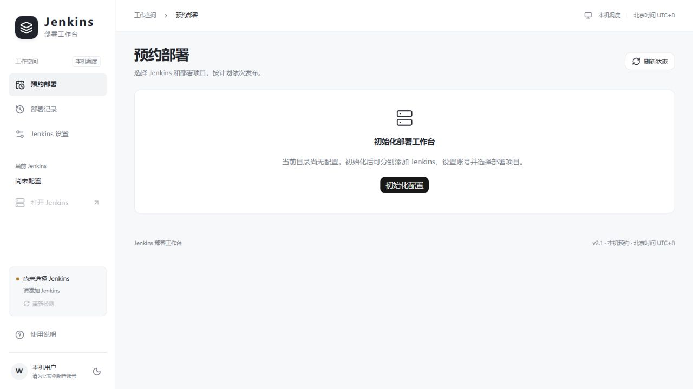

<a id="step-2"></a>
### 2. 添加 Jenkins 地址

在左侧选择 **Jenkins 设置**，点击 Jenkins 列表右上角的 **＋**（添加 Jenkins），填写以下内容，然后点击 **保存**。

| 字段 | 填写方式 |
| --- | --- |
| 显示名称 | 给自己看的名称，例如“测试环境 Jenkins”“生产环境 Jenkins”，便于区分。 |
| Jenkins 地址 | Jenkins 首页地址，例如 `https://jenkins.example.com`。如果访问地址带有 `/jenkins` 前缀，需要完整保留。 |

不要填写 `/user/用户名/account/`、`/user/用户名/configure` 或 `/job/项目名/` 等个人账户页、项目页地址。

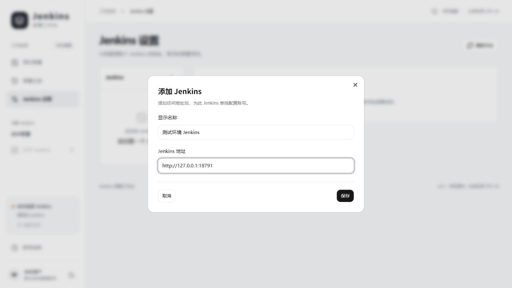

<a id="step-3"></a>
### 3. 配置账号，管理多个 Jenkins

选中刚添加的 Jenkins，在 **连接与账号** 页点击 **设置账号**，填写该 Jenkins 的 **用户名**和 **API Token**，再点击 **验证并保存**。

用户名应填写实际登录账号，而不是个人资料中的显示名称。Token 需要属于这个账号和这个 Jenkins；不要把另一个 Jenkins 的 Token 填到这里。

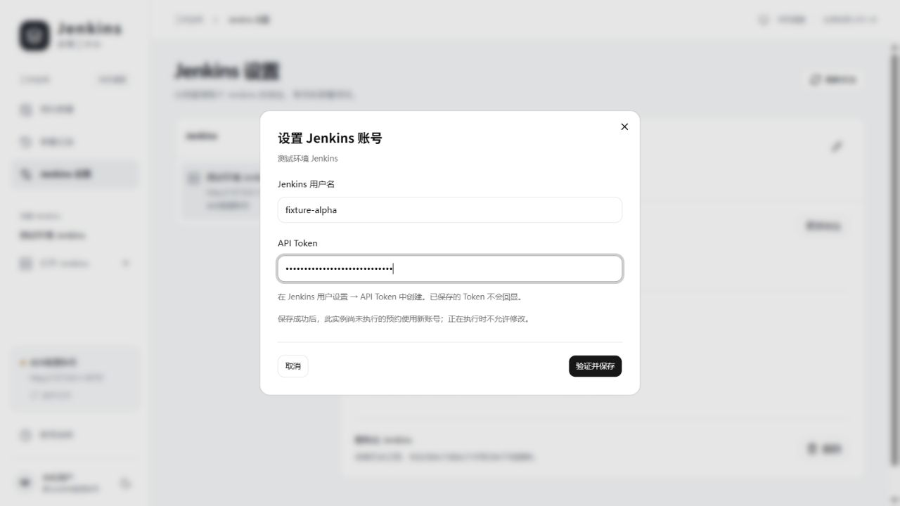

**获取 API Token：** 在浏览器登录目标 Jenkins，打开个人设置，找到 **Security／安全／Configure／设置** 下的 **API Token**，生成一个新 Token 并复制到本工具。不同 Jenkins 版本的入口可能不同；如果当前 `Account` 页面没有 Token 区域，查看个人设置中的“安全”或“配置”入口。保存账号后，工具中的 **打开 Token 设置** 也可作为入口。仍找不到时，请让 Jenkins 管理员检查认证方式和 Token 策略。

保存成功后，页面显示账号名称和验证时间，左下角连接状态应显示 **Jenkins 已连接**。已保存的 Token 不会回显。

有多个 Jenkins 时，重复步骤 2 和 3，分别配置各自账号。点击列表中的某个 Jenkins，可以查看或更新它自己的地址与账号。下图的两个 Jenkins 使用不同的演示账号。

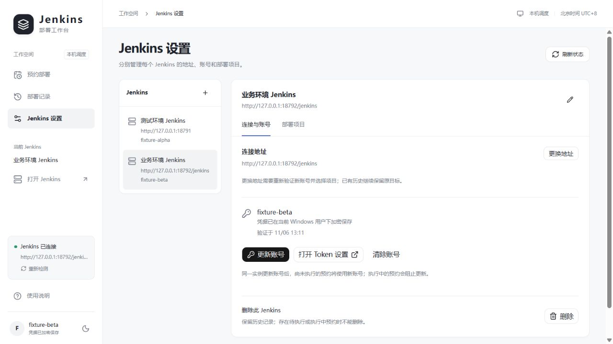

<a id="step-4"></a>
### 4. 读取项目，按分类查找

点击左侧 **预约部署**，在顶部 **预约到 Jenkins** 下拉框选择目标 Jenkins。页面会读取项目；需要更新时点击 **刷新项目**。

- 在 **项目分类** 中选择 Jenkins 的视图分类，例如图中的 `Deploy`；点击 **全部项目** 可取消分类筛选。
- 在搜索框输入项目名称或完整路径，例如 `team-a/deploy`。名称相同的项目应通过完整路径区分。
- 勾选本次要部署的项目。可以直接在这里选择，无需先到设置页额外纳管。
- Jenkins 新增了项目或分类时，点击 **刷新项目** 或 **刷新分类**；若提示尚未读完，点击 **继续读取**。

分类来自当前账号可见的 Jenkins Views，各 Jenkins 的分类可能不同。切换分类或搜索时，已经选择的项目、顺序和参数会保留；灰色的不可构建项目不能选择。

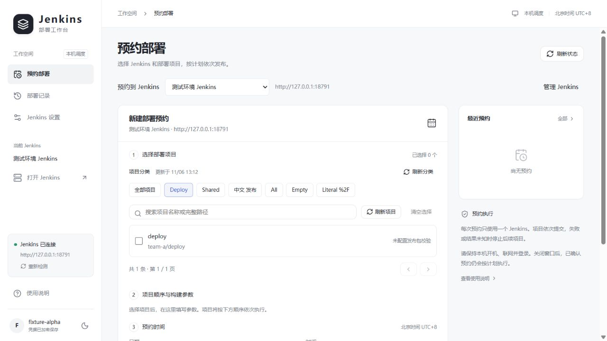

<a id="step-5"></a>
### 5. 填写构建参数，调整顺序

勾选项目后，向下滚动到 **项目顺序与构建参数**，展开项目卡片。工具会从 Jenkins 读取参数定义和默认值，按实际发布需求填写。

| 参数控件 | 操作方式 |
| --- | --- |
| 文本 | 输入分支、版本号等值。 |
| 多行文本 | 输入发布说明等内容，支持换行。 |
| 布尔值 | 勾选为 `true`，不勾选为 `false`。 |
| 下拉选项 | 从 Jenkins 提供的选项中选择。 |

图中的 `REVISION`、`NOTES`、`DRY_RUN`、`ENVIRONMENT` 只是演示项目的参数，实际名称和含义由你的 Jenkins 项目决定；不能仅凭 `DRY_RUN` 这个名称判断项目一定不会部署。普通构建会显示“此项目不需要构建参数”。不支持的参数类型会显示原因，需要移除该项目后再预约。

从 v2.1.1 起支持 **Git Parameter 插件**：例如 `BRANCH` 会显示 Jenkins 返回的分支或标签下拉列表。选择要构建的值；新增分支后点击 **刷新参数**。默认值 `main` 只有在唯一匹配 `origin/main` 这类远程分支时才会自动选中；没有明确默认值时需要手动选择。预约保存完整所选值，执行前会再次核对，分支已删除或列表读取失败时停止执行，不会自动改选其他分支。

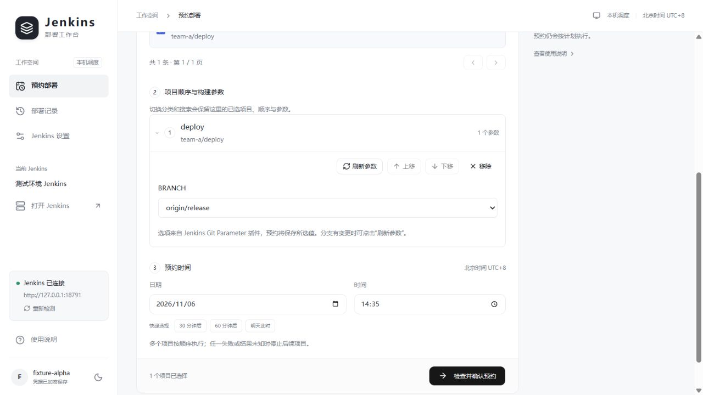

一次选择多个项目时，用 **上移／下移** 调整执行顺序。每个项目执行结束后才会继续下一个；任一项目失败或结果未知时，停止后续项目。

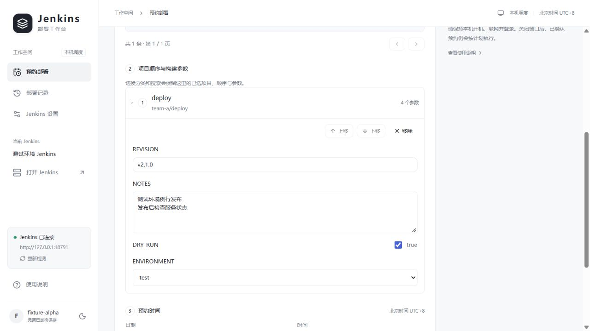

<a id="step-6"></a>
### 6. 设置预约时间

继续向下滚动到 **预约时间**，选择未来的日期和时间，也可以使用 **30 分钟后／60 分钟后／明天此时** 快捷按钮。

所有预约均按 **北京时间 UTC+8** 显示和执行。核对完已选项目、参数和时间后，点击页面底部的 **检查并确认预约**。

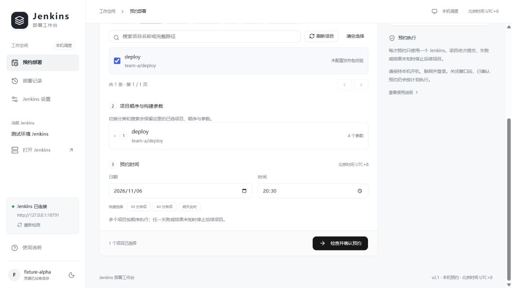

<a id="step-7"></a>
### 7. 检查并确认预约

工具检查项目与参数后，会打开 **确认部署预约** 窗口。逐项核对 **Jenkins 名称和地址、预约时间、项目路径、执行顺序、构建参数**。启用了发布包校验的项目，还会显示包信息与 SHA256。

信息有误时点击 **返回修改**；确认无误后，向下滚动到窗口底部，点击 **确认预约**。仅打开这个核对窗口，还没有创建 Windows 定时任务。

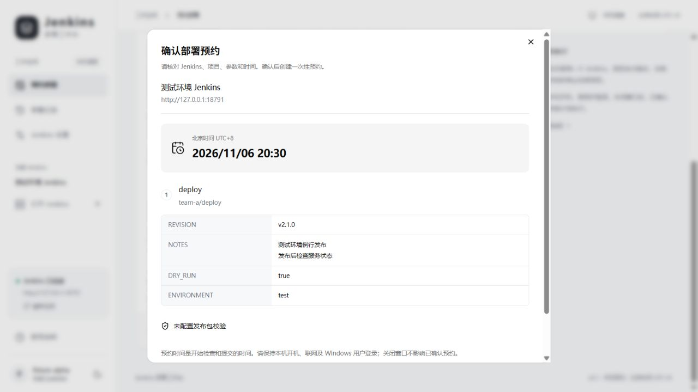

确认成功后，预约详情会显示 **等待执行**，并出现在最近预约和部署记录中。如果系统弹出任务注册所需的管理员授权，请按单位权限要求完成授权；如果显示注册失败，应先处理错误，再重新预约。

**预约生效后的运行条件：** 电脑必须保持开机、不休眠、连接 Jenkins 所在网络，且创建预约的 Windows 用户保持登录。界面可以关闭。预约时间是开始检查和提交的时间，不是部署完成时间；超过预约时间 5 分钟不补发。

<a id="step-8"></a>
### 8. 查看部署记录与详情

点击左侧 **部署记录**。可以按 Jenkins、状态筛选，也可以搜索项目路径或预约编号。点击某条记录右侧的 **详情**，查看本次预约保存的目标与参数。

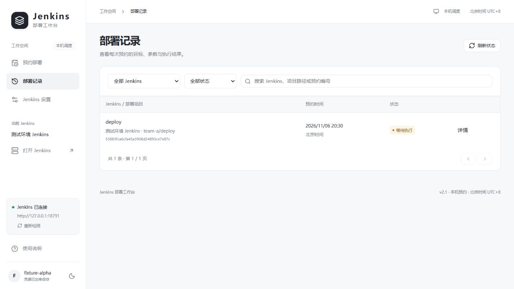

详情中会展示当前状态、执行说明和各项目结果。产生构建编号后，会出现 **构建 #编号 日志** 按钮，可以打开对应 Jenkins 控制台；有执行事件时，可以展开 **执行记录**。下图展示一条尚未执行的预约及其详情底部。

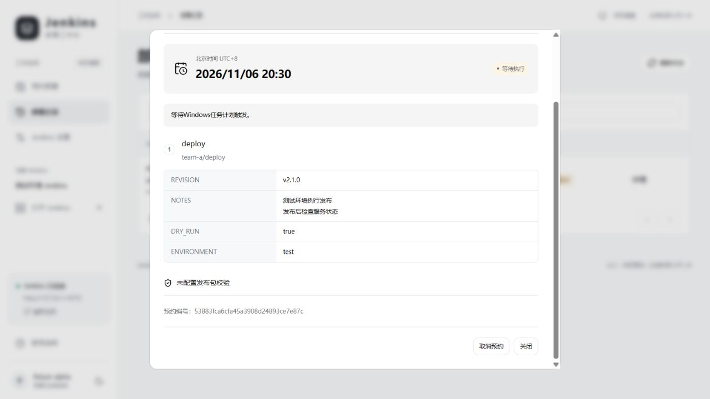

| 状态 | 如何处理 |
| --- | --- |
| 等待执行 | 预约已登记，保持电脑和网络满足执行条件。 |
| 执行中 | 正在检查或构建，等待结果，避免重复预约。 |
| 全部成功 | 所选项目的 Jenkins 构建均已成功，按项目要求继续做业务验收。 |
| 失败，后续已停止 | 查看详情和 Jenkins 日志，处理原因后重新安排。 |
| 需要人工核对 | 提交或构建结果无法确认，先到 Jenkins 核实，避免重复触发。 |
| 已过期，未部署 | 错过允许的执行窗口，确认需要发布后重新预约。 |
| 已取消 | 该预约不会再执行，历史记录保留。 |
| 未执行：另一预约正在运行 | 本机另一预约占用了执行位置，本次没有触发部署。 |

<a id="step-9"></a>
### 9. 取消或重新安排预约

对仍处于 **等待执行** 的记录，打开 **详情**，在底部点击 **取消预约**。再次核对 Jenkins、项目和时间，然后点击 **确认取消**；状态变为 **已取消** 才表示取消完成。

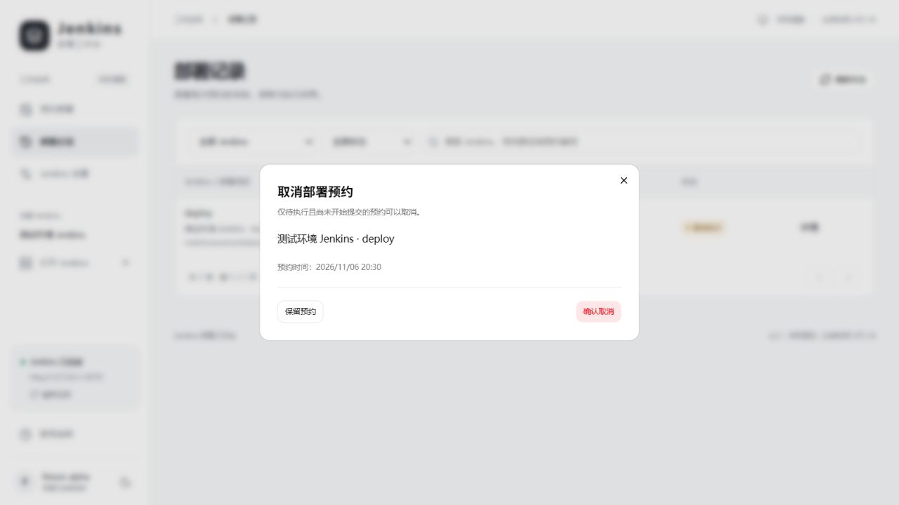

需要改时间或参数时，先取消原来的待执行预约，再新建一条。已经开始执行的预约不能在这里取消；取消预约也不会撤销已经完成的 Jenkins 构建。

## 常见问题

| 问题 | 检查方法 |
| --- | --- |
| 找不到 API Token | 查看个人设置的“安全／配置”入口；Jenkins 版本和认证策略可能不同，必要时联系管理员。 |
| 验证账号失败 | 检查 Jenkins 首页地址、用户名、Token 是否匹配，以及本机网络或 VPN 是否能访问该 Jenkins。 |
| 找不到项目或分类 | 先选对 Jenkins，切回“全部项目”并清空搜索，再刷新项目和分类；确认当前账号有查看权限。 |
| 提示“不支持的参数” | Git Parameter 请升级至 v2.1.1 或更新版本；密码、文件上传及其他未适配的插件参数仍不能预约。 |
| Git 分支或标签列表读取失败 | 在 Jenkins 的“Build with Parameters”页面核对插件、仓库配置和账号权限，再重试读取；工具不会使用插件出错时返回的默认分支替代真实列表。 |
| Windows 任务注册失败 | 核对 Task Scheduler 服务、当前 Windows 账号权限和管理员授权结果；记录失败时不代表预约已成功。 |
| 关掉程序后还会执行吗 | 已确认的预约由 Windows 任务计划程序执行，界面可关闭；电脑、网络和登录状态仍须满足上述条件。 |
| “未配置发布包校验”是什么 | 项目未启用可选的 ZIP/SHA256 校验，可以按 Jenkins 构建流程预约；如业务需要，在“Jenkins 设置 → 部署项目”中配置。 |
| 同事能看到我的账号和预约吗 | 每人独立安装、独立保存。其他人的安装不会同步本机配置与预约。 |

## 功能与边界

- 多 Jenkins、多账号；支持 Jenkins Views 分类、Folder 和项目搜索。
- 普通构建和参数化构建，预约保存项目及参数快照。
- API Token 使用当前 Windows 用户的 DPAPI 加密，不能直接复制给其他用户使用。每个人应填写自己的账号；其他人无法看到本机预约。
- 可选 ZIP 发布包的 SHA256 校验。只支持程序明确识别的参数类型，不会猜测插件参数。
- 升级和卸载前先关闭界面，并取消待执行预约或等待其结束。数据不会随程序文件回滚，也不会重新执行已消费的预约。
- 本工具不需要专用服务器；多人独立安装也意味着各自可能对同一个项目预约，请自行协调部署窗口。

## 源码开发

需要 Python 3.13、Bun、Rust stable MSVC，以及 Visual Studio C++ Build Tools / Windows SDK。

```powershell
python -m unittest discover -s tests -v
cd desktop
bun install --frozen-lockfile
bun run lint
bun run typecheck
bun run tauri build --no-bundle
cd ..
python tools/build_release.py --exe desktop/src-tauri/target/release/tauri-native.exe
```

安装包与校验文件生成在 `artifacts/`。构建脚本从官方站点下载固定版本的 Python 和 NSIS，并校验 SHA256；WebView2 引导程序验证微软数字签名。只使用临时目录和本机模拟 Jenkins 做测试，不要用真实部署验证安装包。

详见 [发布说明](docs/RELEASE.md)、[桌面开发说明](desktop/README.md) 和 [第三方许可](docs/THIRD_PARTY_NOTICES.txt)。
